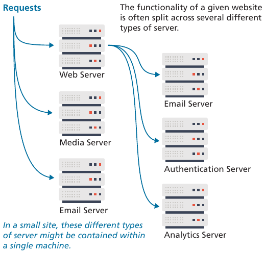

# Aula 16 - Comunicação Cliente-Servidor

## Arquitetura Clássica

<div style="display:flex;gap:50px;">
    <div>
        <h3>Cliente</h3>
        <ul>
            <li>Máquinas comuns (baixas capacidades de memória, de processamento, etc.)</li>
            <li>Fazem requisições de <b>recursos</b>, geralmente através de navegadores web.</li>
        </ul>
    </div>
    <div>
        <h3>Servidor</h3>
        <ul>
            <li>Máquinas poderosas (grandes capacidades de memória, de processamento, etc.</li>
            <li>Recebem as requisições e <b>respondem</b> aos <i>clientes</i>.</li>
        </ul>
    </div>
</div>

<figure style="text-align:center;">
    
</figure>

Outros componentes:

- A `rede`: permite a comunicação entre cliente e servidor.
- Os `protocolos`: permitem que cliente e servidor se entendam ao seguirem um conjunto de regras. Os mais comuns:
  - `HTTP`/`HTTPS` para navegação na web.
  - `SMTP` para troca de e-mails.
  - `FTP` para a transferência de dados (será descontinuado, pois o HTTP já o substituiu na prática).

## Tipos de arquitetura

- Arquitetura de 1 camada (`1-tier`)
  - Variação onde todas as camadas (**apresentação**/**interface de usuário**, **lógica de negócios** e o **banco de dados**) residem em um único dispositivo.
- Arquitetura de 2 camadas (`2-tier`)
  - Existem duas partes separadas: `cliente` e `servidor`. O `cliente` lida com a **apresentação** e parte da **lógica de negócios**. O `servidor` fica responsável pelo armazenamento e gerenciamento de dados (ou seja, a maior parte da **lógica de negócios**).
- Arquitetura de 3 camadas (`3-tier`)
  - Padrão moderno para as aplicações web. O `cliente` fica com a camada de **apresentação**, o processamento da **lógica de negócios** ocorre no `servidor` (*middleware* ou *application server*), e os dados ficam em um *database server*.
- Arquitetura de múltiplas cmadas (`n-tier`)
  - Refere-se a quaisquer variações com mais de 3 camadas.

## Tipos de servidores

- **Web server**
  - Um computador atendendo a requisições HTTP.
  - Tipicamente esse tipo de servidor se refere a computadores executando um software de servidor web, como Apache, Microsoft IIS (Internet Information Systems) ou Nginx.
- **Application server**
  - Um computador que hospeda e executa aplicações web, os quais podem ser criados por qualquer tecnologia de desenvolvimento web.
- **Database server**
  - Um computador dedicado a executar um *Database Management System* (DBMS), como MySQL, Oracle, MongoDB, etc.
- **Mail server**
  - Um computador que cria e responde a requisições de e-mail.
  - Tipicamente executam o protocolo *Simple Mail Transfer Protocol* (SMTP).
- **Media server**
  - Também chamado de *streaming server*, é um servidor dedicado a atender requisições para imagens e vídeos.
  - Pode executar software especial que permita o *streaming* de conteúdos de vídeo aos clientes.
- **Authentication server**
  - Lida com uma das necessidades de segurança mais necessárias de aplicações web.
  - Sua execução pode envolver a interação com recursos de rede local, como o *Lightweight Directory Access Protocol* (LDAP) ou *Active Directory*.

<figure style="text-align:center;">
    
</figure>

## HTTP

O *Hypertext Transfer Protocol* (HTTP) é atualmente definido nos RFCs 

- [9110](https://www.rfc-editor.org/info/rfc9110/) - HTTP Semantics: descreve a arquitetura geral, estabelece terminologia comum e define aspectos do procotolo que são compartilhados por todas as versões. Nessa definição estão presentes os elementos centrais do protocolo, mecanismos de extensibilidade, e os esquermas URI (*Uniform Resource Identifier*) "http" e "https".
- [9112](https://www.rfc-editor.org/info/rfc9112/) - HTTP/1.1: especifica a sintaxe e análise (*parsing*) de mensagens, gerenciamento de conexão e questões de segurança relacionadas.

É o protocolo padrão para troca de mensagens e dados da Internet na atualidade, ou seja, a maioria das aplicações web rodam sobre o HTTP.

Ele é executado em dois programas: um **cliente** e um **servidor**. O programa cliente envia mensagens `Request` e o programa servidor envia mensagens `Response`. Por padrão, roda sobre o protocolo TCP.

A mensagem de requisição (`Request`) possui três elementos principais:

1. **Dados de controle**
    - [**Método**](https://www.rfc-editor.org/info/rfc9110/#section-9) de requisição/solicitação
      - `GET`, `HEAD`, `POST`, `PUT`, `DELETE`, `TRACE`, `OPTIONS` e `CONNECT`.
    - **Alvo**/**destino** da solicitação
      - A URL para identificar um recurso no servidor.
    - **Versão** do HTTP (/1.1, /2 ou /3).
2. **Campos de cabeçalho**
    - Sequência de linhas de campos de cabeçalho (pares `nome: valor`). Cada campo de cabeçalho pode modificar ou estender a semântica da mensagem, descrever o remetente, definir o conteúdo ou fornecer contexto adicional.
    - Alguns dos campos de cabeçalho mais comuns: `Host`, `Connection`, `User-agent`, `Accept-language`.
    - Lista de nomes de campo de cabeçalho: [HTTP Field Name Registry](https://www.iana.org/assignments/http-fields#field-names).
3. **Conteúdo**
    - Conteúdo a ser enviado para o cliente ou para o servidor.
    - Em muitos casos resume-se a um JSON.

A mensagem de resposta (`Response`) possui os mesmos elementos. As diferenças principais são:

- Nos **dados de controle** a sequência consiste na versão do protocolo, seguida de um [**código de status**](https://www.rfc-editor.org/info/rfc9110/#section-15) e opcionalmente a mensagem do código de status.
  - 1xx: Informacional - requisição recebida, processo em continuação;
  - 2xx : Sucesso - a ação foi recebida com sucesso, entendida e aceita;
  - 3xx : Redirecionamento - mais ações precisam ser tomadas para completar a requisição;
  - 4xx : Erro do Cliente - a requisição contém erro de sintaxe ou não pode ser atendida;
  - 5xx : Erro de Servidor - o servidor falhou em atender uma requisição supostamente válida.
- **Conteúdo** costuma sempre estar presente.

## APIs

Uma API (*Application Programming Interface*) é uma **interface** que um programa apresenta a outros programas e a humanos. São os blocos de construção que permitem a interoperabilidade das principais plataformas de negócios da web.

As APIs surgiram da necessidade de trocar informações com fornecedores de dados que estão capacitados para resolver problemas específicos. Assim, as pessoas das outras empresas não precisam gastar tempo resolvendo esses problemas por conta própria. Não precisamos reinventar/reimplementar, por exemplo

- Google maps;
- Sistemas de pagamento;
- Vinculação de contas.

Ou seja, elas permitem que novos produtos sejam desenvolvidos rapidamente, de forma que empresas/*startups* possam focar no diferencial de seu produto enquanto utilizam diversas soluções prontas.

Hoje em dia, boa parte das aplicações web se "confundem" com APIs, no sentido de que consistem em serviços que podem ser consumidos diretamente pelo usuário e, ao mesmo tempo, como parte de outra aplicação. Além disso, os mesmos fundamentos utilizados para a implementação de APIs são utilizados na implementações de aplicações web.

### Paradigmas de APIs

Os dois principais **tipos de paradigma** são:

- APIs de Requisição-Resposta (*Request-Response APIs*)
  - Tipicamente expõem uma interface através de um servidor web baseado em HTTP.
  - Definem um conjunto de *endpoints*.
  - Clientes fazem requisições a esses *endpoints* e o servidor retorna as respostas, normalmente como JSON ou XML.
  - Os principais paradigmas são:
    - REST;
    - RPC;
    - GraphQL.
- APIs Orientadas a Eventos (*Event-Driven APIs*)
  - São voltadas a serviços com dados que são modificados com frequência.
  - Em vez de ficar fazendo requisições com uma certa frequência, essas APIs compartilham dados sobre eventos em tempo real:
    - *WebHooks*;
    - *WebSockets*;
    - *HTTP Streaming*.

### RESTful APIs

**REST** (*REpresentational State Transfer* - Transferência de Estado Representacional) é um estilo arquitetural originalmente proposto por [Roy T. Fielding](https://ics.uci.edu/~fielding/), em sua tese [Architectural Styles and the Design of Network-based Software Architectures](https://ics.uci.edu/~fielding/pubs/dissertation/top.htm).

Grosso modo, é um conjunto de **restrições**/**princípios de desing** **arquiteturais**. Uma API que emprega essas restrições (teoricamente em ordem) é chamada de **RESTful API**.

#### Restrições

Para que uma API seja considerada verdadeiramente RESTful, ela deve seguir seis restrições fundamentais:

1. **Interface uniforme**: essa restrição define uma interface entre cliente e servidor, o que simplifica e desacopla a arquitetura do sistema, permitindo às partes evoluírem de forma independente. Os quatro princípios guias da interface uniforme são:
   1. **Baseado em recurso**: recursos individuais são identificados nas requisições através de URIs (*Uniform Resource Identifier*). Quando um cliente faz uma requisição através de uma **RESTful API**, ela responde com/transfere uma **representação do estado do recurso**. Essa representação pode ser um HTML, XML, JSON, texto, etc.
   2. **Manipulação de recursos através de representações**: através da representação de um recurso um cliente possui informações suficientes para modificar ou excluir o recurso do servidor (com as devidas permissões, obviamente).
   3. **Mensagens autodescritivas**: cada mensagem inclui informações suficientes para descrever como processar a mensagem. Por exemplo, o *parser* a ser utilizado pode ser especificado por um *Internet media type* (conhecido também por *MIME type*). As respostas também podem indicar explicitamente a "cacheabilidade" do recurso.
   4. **Hipermídia como Motor do Estado da Aplicação**: ou HATEOAS (*Hypermedia as the Engine of Application State*). As requisições enviadas, e respostas recebidas são compostas por corpo de conteúdo, cabeçalhos de requisição/resposta, URI, etc. Isso é referido como hipermídia. Além disso, também faz parte do HATEOAS que, quando necessário, links devam estar contidos nas respostas para permitir a consulta do recurso em si, ou de recursos relacionados.
2. **Stateless**: todas as informações necessárias para que uma requisição possa ser processada estão contidas na própria requisição, como parte da URI, ou de parâmetros, cabeçalho, etc.
3. **Cacheabilidade:** os dados devem ser marcados como cacheáveis ou não para otimizar as interações.
4. **Cliente-Servidor**: separação de preocupações entre a interface do usuário e o armazenamento de dados.
5. **Sistema em Camadas:** o cliente não consegue saber se está conectado diretamente ao servidor final ou a intermediários (como balanceadores de carga).
6. **Código sob Demanda (opcional):** capacidade do servidor de enviar código executável para o cliente.

#### Convenções / Melhores práticas

- [Nomeação de recursos](https://restapitutorial.com/introduction/restquicktips#provide-sensible-resource-names)
- [Métodos](https://restapitutorial.com/introduction/restquicktips#provide-sensible-resource-names)

  Os métodos para uma **RESTful API** devem se alinhar aos métodos de requisição HTTP.

  | **Recurso** | **POST** | **GET** | **PUT** | **DELETE** |
  |---|---|---|---|---|
  | /clientes | Cria um novo cliente | Retorna todos os clientes | Atualização de todos os clientes | Exclui todos os clientes |
  | /clientes/1 | Erro | Retorna os detalhes do cliente 1 | Atualiza os detalhes do cliente 1 (se existir) | Exclui o cliente 1 |
  | /clientes/1/pedidos | Cria um novo pedido para o cliente 1 | Retorna todos os pedidos do cliente 1 | Atualização de todos os pedidos do cliente 1 | Exclui todos os pedidos do cliente 1 |

  Exemplo:

  ```
  POST https://api.padaria.com/clientes/5/pedidos
  Content-Type: application/json; charset=utf-8
  Content-Length: ...

  {"Id":1,"Nome":"Filé à Parmegiana","Preço":25.9}
  ```

  - [Valores de retorno recomendados para cada método HTTP primário](https://restapitutorial.com/introduction/httpmethods#overview).
- [Implementar métodos assíncronos](https://learn.microsoft.com/en-us/azure/architecture/best-practices/api-design#implement-asynchronous-methods)
- [Implementar paginação de dados e filtragem](https://learn.microsoft.com/en-us/azure/architecture/best-practices/api-design#implement-data-pagination-and-filtering)
- [Ter suporte a respostas parciais](https://learn.microsoft.com/en-us/azure/architecture/best-practices/api-design#support-partial-responses)
- [Implementar HATEOAS](https://learn.microsoft.com/en-us/azure/architecture/best-practices/api-design#implement-hateoas)
- [Implementar versionamento](https://learn.microsoft.com/en-us/azure/architecture/best-practices/api-design#implement-versioning)
- etc.

#### A [Iniciativa OpenAPI](https://www.openapis.org/) foi criada por um consórcio da indústria para padronizar as descrições de APIs REST entre diferentes fornecedores. A especificação de padronização era chamada de `Swagger` antes de ser incorporada à iniciativa OpenAPI e renomeada para [OpenAPI *Specification* (OAS)](https://spec.openapis.org/oas/latest.html).

- [Documentação](https://learn.openapis.org/).